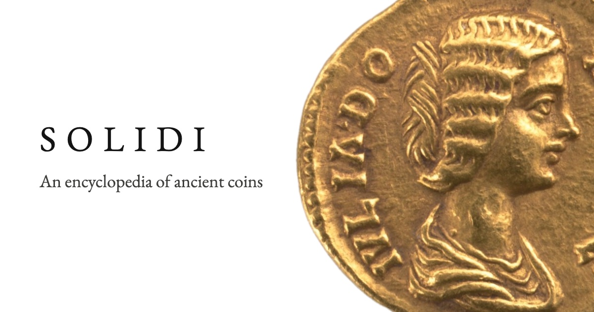

<p align="center">
  
</p>

<h3 align="center">An open encyclopedia of ancient coinage</h3>

<p align="center">
  <a href="https://solidi.org">solidi.org</a> · <a href="#download-the-data">Download the data</a> · <a href="#development">Development</a>
</p>

Solidi turns the open scholarly coin catalogues into one readable site: about 100,000 coin types from Archaic Greece to late Rome, each with its ruler, mint, date, translated legends and photographs of surviving specimens from 73 museums and collections.

The data comes from the American Numismatic Society's catalogues ([OCRE](http://numismatics.org/ocre/), [CRRO](http://numismatics.org/crro/) and the Hellenistic corpora), Oxford's [IRIS](https://greekcoinage.org/iris/), [Corpus Nummorum](https://www.corpus-nummorum.eu/), [Nomisma.org](https://nomisma.org), [Pleiades](https://pleiades.stoa.org) and [Wikidata](https://www.wikidata.org). Photographs are credited to the collection that holds each coin.

## Download the data

The full database is a single SQLite file under the ODbL, on the [Releases](../../releases) page.

```sh
gunzip solidi.sqlite.gz && uvx datasette solidi.sqlite
```

## Development

Requires [uv](https://docs.astral.sh/uv/) and Node 22.

```sh
uv sync
uv run solidi build --authority trajan --build-dir build/trajan   # one emperor, for speed
uv run solidi export-d1 --build-dir build/trajan

cd site && npm install && npm run db:local && npm run dev
```

Drop `--authority` and `--build-dir` to build everything (about 1 GB of downloads, cached in `build/raw/`). Run the tests with `uv run pytest`.

`pipeline/` builds the database, `data/` holds the hand-maintained inputs, and `site/` is the Astro website on Cloudflare.

## Contributing

Corrections are welcome. If a type's data is wrong at its source catalogue (linked from every page), report it there; otherwise open an issue or pull request here.

## Licences

Code is MIT. The database is ODbL. Hand-written data in `data/` is CC BY 4.0 (see `data/LICENSE`). Photographs stay under each holder's terms, and Wikipedia text under CC BY-SA 4.0. Corpus Nummorum (CC BY-NC-SA) is left out of the download.
